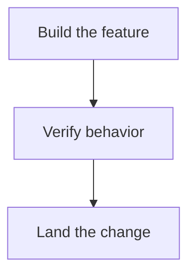

# Release confidence

Build the agreed experience, verify the actual release, and preserve its evidence.
This is synthetic renderer input, not a report of a consumer release.

## Product decision

Use the reviewed prototype and user feedback as the acceptance baseline.

::: callout-question
### What still needs proof?

The live flow must match the agreed behavior.
:::

| Outcome | State | Evidence |
|---|---|---|
| Local build | Accepted | Synthetic fixture |
| Live flow | Deferred | Not a deployed application |

## Release flow

<!-- forge-include: parts/graph.md -->

## Next document

[Implementation record](02_implementation.md#handoff)
